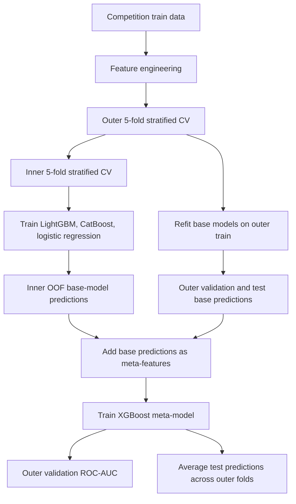

# Predict Customer Churn — Kaggle Playground Series S6E3

**Stacked ML solution | Out-of-fold ROC-AUC: 0.916630**

This repository documents my notebook for Kaggle's [Playground Series — Season 6, Episode 3: Predict Customer Churn](https://www.kaggle.com/competitions/playground-series-s6e3/overview). The goal is to **predict whether a telecom customer will churn** from contract, payment, usage, service-subscription and demographic features.

Like my [Heart Disease Prediction write-up](https://github.com/EmreDuman221/Predicting-Heart-Disease---S6E2), this README focuses on **what the code actually does**: feature engineering, encodings, cross-validation, model training, ensembling and the reported results. The exact original modeling logic is preserved in the [annotated notebook](customer_churn_s6e3.ipynb), except that an unused dataset read and boilerplate imports have been removed.

> **Metric qualification:** `0.916630` is the **out-of-fold ROC-AUC printed by the supplied notebook**, not a Kaggle public/private leaderboard score or an untouched independent test score. Some models use their outer validation fold for early stopping; see [Validation caveats](#validation-caveats).

## Project at a glance

| Component | Implementation |
|---|---|
| Task | Binary classification: `Churn` (`Yes` = 1, `No` = 0) |
| Dataset | Kaggle Playground Series S6E3 training and test CSVs |
| Input preparation | Missing-value treatment, categorical recoding, quantitative binning |
| Feature engineering | Customer tenure, contracts, service bundles, charges, risk flags, category interactions |
| Encodings | Per-split frequency encoding and mean target encoding |
| Base models | LightGBM, CatBoost, L2 logistic regression |
| Meta-model | XGBoost on engineered features plus three base-model predictions |
| Validation | 5 stratified outer folds × 5 stratified inner folds |
| Metric | ROC-AUC |
| Recorded result | Stacked OOF ROC-AUC **0.916630** |

## 1. Data and target

The notebook reads:

```python
train = pd.read_csv('/kaggle/input/competitions/playground-series-s6e3/train.csv')
test = pd.read_csv('/kaggle/input/competitions/playground-series-s6e3/test.csv')
```

The competition identifier `id` is removed from predictive features, and `Churn` is converted from `Yes`/`No` to `1`/`0`. The original notebook also read an additional public Telco Customer Churn file into an `original` variable. **That file was not concatenated with the competition data or used in model fitting**; the documented notebook therefore removes the unused read to simplify setup.

The 15 initial categorical features cover `Contract`, `PaymentMethod`, `InternetService`, service addons, and customer attributes; the four numeric variables are `MonthlyCharges`, `TotalCharges`, `tenure`, and `SeniorCitizen`.

## 2. Feature engineering

The `engineer_telco_features(df)` function builds domain-inspired predictors from telecom account information.

### Service and subscription features

- Convert service columns to binary indicators and create `ServiceCount` / `num_addons`.
- Derive `HasInternet`, `IsFiber`, `IsAutoPay`, and `IsElectronicCheck` (not every created indicator is selected for modeling).
- Encode the contract type as `ContractNum` and payment method as `PaymentMethodNum`.

### Tenure, charges and interactions

- `ContractTenureScore = ContractNum * tenure`
- `ChargesPerMonth = TotalCharges / (tenure + 1)`
- `MonthlyCharges_x_ServiceCount = MonthlyCharges * ServiceCount`
- Numeric bucketing with `qcut` for monthly charges, tenure and total charges; additional coarse rounding features.

### Customer-segment indicators

Examples include `stable_customer`, `unstable_customer`, `risk_customer`, `fiber_high_price`, `high_price_short_tenure`, and `no_addons_high_price`.

These are **candidate predictive features**, not experimentally established causes of churn; their names express modeling hypotheses, not proven causal relations.

## 3. Categorical pair features

Nine hand-selected pairs combine values into context-specific categories, including:

```python
('Contract', 'PaymentMethod')
('Contract', 'PaperlessBilling')
('InternetService', 'TechSupport')
('InternetService', 'OnlineSecurity')
('Partner', 'Dependents')
```

Each pair is represented as a combined category such as `Month-to-month__Electronic check`. The original notebook constructs **nine** such pair features.

## 4. Frequency encoding and target encoding

For each categorical feature `c`, the encoding function learns mappings from its input training split:

**Frequency encoding:**

```python
freq_map = train_df[c].value_counts(normalize=True)
```

This captures how common each category is in the training portion.

**Target encoding:**

```python
global_mean = y_train.mean()
target_map = y_train.groupby(train_df[c]).mean()
```

This maps a category to its observed mean churn rate. Validation/test rows are transformed using the training mapping; unseen categories receive the training global target mean. The model receives 24 frequency-encoded columns and 24 target-encoded columns (15 original categorical columns plus 9 pairs), together with 4 numeric and 26 engineered numeric columns: **78 numeric model inputs** in total.

**Important:** training rows' target encodings are computed from their own training labels. This should be replaced by cross-fitted, out-of-fold encodings in a hardened pipeline to reduce target overfitting. The outer validation rows do not directly enter those maps, but this does not eliminate the training-row issue.

## 5. Stratified cross-validation and stacking

The core workflow uses `OUTER_FOLD = 5` and `INNER_FOLD = 5`, each based on `StratifiedKFold(shuffle=True, random_state=42)`.



### Inner folds: build stacking features

Within each outer-training split, the code runs five inner folds. LightGBM, CatBoost and logistic regression generate predictions for held-out rows. These are saved in arrays named:

```python
lgbm_oof_outer
cat_oof_outer
lr_oof_outer
```

Because each inner prediction is produced by a model that did not fit on that inner-validation target row, these arrays act as training features for the meta-model.

### Outer fold: refit and stack

The three base models are refitted on the full outer-training subset. Their predicted churn probabilities for outer-validation rows and competition-test rows become additional features:

```python
X_train_xgb['lgbm_pred'] = lgbm_oof_outer
X_train_xgb['cat_pred']  = cat_oof_outer
X_train_xgb['lr_pred']   = lr_oof_outer
```

Those three prediction features are appended to the original engineered and encoded numerical features. An **XGBoost classifier** is trained on the resulting meta-feature matrix. Five outer-fold test predictions are averaged to make the Kaggle submission.

Although the notebook contains commented-out XGBoost/Ridge base learner experiments and commented-out alternative CatBoost stacking code, the **executed stack uses LightGBM + CatBoost + logistic regression, with XGBoost as the meta-model**.

## 6. Model configuration

- **LightGBM:** 5,000 estimators maximum, learning rate 0.01, leaf/depth regularization, AUC evaluation and early stopping.
- **CatBoost:** 8,000 iterations maximum, learning rate 0.01, depth 5, ordered boosting, class balancing and AUC evaluation.
- **Logistic regression:** standardized numeric features, L2 penalty, `liblinear` solver.
- **XGBoost meta-model:** 3,000 estimators, learning rate 0.02, max depth 4, histogram tree algorithm, AUC evaluation.

These are the configurations in the supplied notebook; the project does **not** include a documented Optuna search or a systematic hyperparameter-tuning study for this churn run.

## 7. Results

The saved run reports these outer-fold results:

| Outer fold | ROC-AUC |
|:--:|--:|
| 1 | 0.916370 |
| 2 | 0.917269 |
| 3 | 0.916751 |
| 4 | 0.917886 |
| 5 | 0.915014 |
| **Overall OOF** | **0.916630** |
| Mean outer-fold AUC | 0.916658 |
| Std. dev. of fold AUC | 0.000967 |

The final code exports `submission.csv` with an `id` and predicted `Churn` probability for each test row. The file is excluded from version control.

## 8. Validation caveats

This is an accurate description of the original notebook, not a claim that all aspects of the validation design are leakage-proof.

1. **Outer-fold model selection:** LightGBM's early stopping and CatBoost's `use_best_model=True` both use the same outer validation labels that are subsequently scored. This can bias reported outer-fold ROC-AUC upward. A fully held-out assessment requires separate model-selection folds or proper nested training of all tuning decisions.
2. **Target-encoding fit:** each base model sees training rows with category target means fitted using those same rows' targets. Cross-fitting those encodings would mitigate overfitting.
3. **Preprocessing across splits:** numeric medians and quantile-bin boundaries are calculated independently for the full train and test frames before cross-validation. Fit preprocessing inside each training fold and apply the learned mappings consistently.
4. **Stacking consistency:** inner-OOF base predictions and base models refit on full outer training use different encoding fits. A more rigorous pipeline would align these transformations and use cross-fitting throughout.
5. **Scope:** ROC-AUC measures ranking discrimination. The notebook does not establish calibration, business lift, a causal retention effect, or deployment performance. It also does not record a public/private leaderboard score or a final competition rank.

These caveats are valuable next steps if this notebook is extended beyond a competition exercise.

## 9. How to reproduce

The easiest way to run the notebook is on **Kaggle**:

1. Open the [competition page](https://www.kaggle.com/competitions/playground-series-s6e3/overview) and accept its rules to access the data.
2. Create a Kaggle notebook with the competition data attached.
3. Upload `customer_churn_s6e3.ipynb` and confirm the `/kaggle/input/competitions/playground-series-s6e3/` paths.
4. Run all cells. The nested stacking workflow trains multiple models and may use substantial compute.
5. Inspect the OOF scores and the generated `submission.csv`.

For a local environment, install dependencies using `pip install -r requirements.txt`, download the Kaggle CSVs (subject to Kaggle competition access), and change the input paths in the notebook. The exact package versions from the original Kaggle run were not exported, so this is a dependency list rather than a fully locked environment.

## 10. Repository contents

```text
Customer-Churn-Prediction-S6E3/
├── README.md                     # This explanation
├── customer_churn_s6e3.ipynb     # Documented notebook and recorded outputs
├── requirements.txt              # Core Python dependencies
└── .gitignore                    # Excludes datasets, secrets, generated files
```

## 11. Further improvements

- Use cross-fitted target encoding with smoothing for rare categories.
- Move missing-value imputation and quantile bins inside each CV fold.
- Reserve an untouched validation/test split for model evaluation and early-stopping independence.
- Compare against simpler non-stacked baselines and test calibration, precision/recall and operational top-k recall.
- Explore interpretable churn risk segments, while avoiding unsupported claims about causal drivers.

**Author:** Emre Duman · [Kaggle](https://www.kaggle.com/emreduman05) · [GitHub](https://github.com/EmreDuman221)
